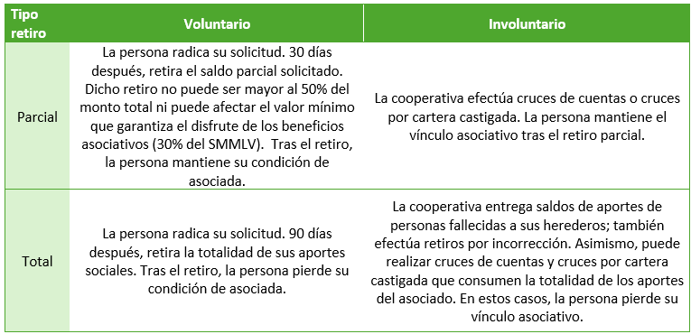
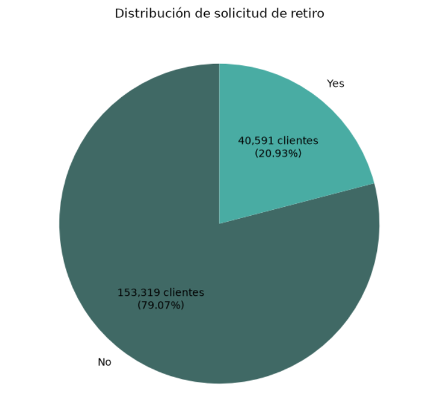

## Introducción

Para Confiar, la actividad financiera es el medio que le permite contribuir al Bienvivir, tanto de sus miembros, como de los territorios donde estos se localizan, a través de un portafolio de productos de ahorro y crédito, programas y servicios sociales, culturales y ambientales. El fundamento que sustenta estas acciones es el vínculo asociativo, a través del cual se abre la posibilidad de sumarse a los propósitos de la organización y beneficiarse de estos. Una manifestación concreta del vínculo asociativo son los aportes sociales, es decir, las contribuciones económicas realizadas por quienes deciden, libre y voluntariamente, incorporarse a la cooperativa en calidad de asociados.

La estimación de las tasas de abandono (churn) anual permite observar una estabilización en el retiro de clientes y de saldos de aportes sociales ocurridos en los últimos tres años. Pese a ello, Confiar busca alternativas para mejorar este indicador. Al aplicar las clasificaciones del retiro de clientes propuestas por Lozano (2014) a la realidad de Confiar, se aprecia que el churn en la organización puede contemplarse desde dos perspectivas:

- La magnitud de la ruptura: se puede hacer un retiro parcial o total de saldos de aportes.
- La voluntad del asociado en la ruptura: las personas pueden retirarse por voluntad propia, o la cooperativa puede actuar unilateralmente por cruces de cuentas o de cartera, por incorrección o por voluntad de los herederos de fallecidos. 

La siguiente tabla presenta los posibles cruces entre ambas perspectivas.

El *retiro total voluntario* ha recibido especial atención por parte del área comercial y de mercadeo. En la actualidad, tanto los canales presenciales como no presenciales aplican un protocolo de atención a los asociados que quieren abandonar definitivamente la cooperativa. Sin embargo, dicho protocolo es reactivo: es decir, solo se pone en marcha cuando el asociado trata de radicar su solicitud. La literatura consultada muestra que otras cooperativas financieras han evidenciado la misma limitación y que, ante ello, han optado por utilizar las bases de datos de sus miembros para desarrollar ejercicios de Machine Learning que les permitan conocer su conducta, predecir su retiro y, a partir de ello, implementar estrategias reactivas de retención (Tafur y Dairo (2024), Bonilla, Montero y González (2021), Zambrano (2019)). Por esta razón, el ejercicio que se presenta a continuación pretende replicar estas experiencias al interior de Confiar, para lo cual explorará el comportamiento de los clientes que se han asociado entre 2017 y 2025 con el fin de predecir la probabilidad de radicación de solicitudes de retiro total, a partir de la aplicación de seis modelos: Baseline, Regresión Logística, Árbol de Decisiones, Random Forest, KNN Neighbors y Gradient Boosting. Una vez identificado el modelo qué más se ajusta al caso de negocio, se procederá a incorporarlo en una aplicación que facilite la estimación de la probabilidad de radicación de solicitud de retiro de los asociados. 

## Objetivos

Predecir la probabilidad de que un asociado de Confiar decida radicar una solicitud de retiro total e identificar los factores que propician su retención mediante el uso de una aplicación.

## Instrumentos

**Librerías:** Openpyxl, Pandas, NumPy, Matplotlib, Seaborn, Scikit-Learn, Shap.

**Modelos:** Baseline, Regresión Logística, Árbol de Decisiones, Random Forest, KNN Neighbors y Gradient Boosting.

## Estructura del proyecto

El proceso de entrenamiento, validación y testeo de modelos de machine learning que se propone a continuación consta de los siguientes pasos:

0. Configuración (carga de librerías)

1. Carga del dataset, revisión, ajustes e identificación de variable objetivo.

2. Partición del dataset en conjuntos para entrenamiento (80% de los datos), validación de aprendizaje (10% de los datos) y testeo final (10% de los datos).

3. Preparación del torneo, es decir, selección de los modelos a probar y de las métricas de evaluación.

4. Entrenamiento de los modelos y conservación de aprendizajes obtenidos por cada uno.

5. Validación de los aprendizajes obtenidos por cada modelo. Con base en dicha validación, se define un modelo ganador.

6. Ajustes al modelo seleccionado reentrenamiento con base en los datos combinados de testeo y validación.

7. Testeo final: aplicación de los aprendizajes del modelo reentrenado a la base de datos de testeo.

8. Explicabilidad: identificación de los predictores con mayor influencia sobre la variable objetivo.

## Dataset

Previamente, se obtuvieron datos tipo panel de corte mensual con variables sociodemográficas, financieras, relacionales y transaccionales de asociados vinculados entre 2017 y 2025. Luego, estos datos fueron transformados teniendo en cuenta:

+ El trabajo de Fajardo y Motta (2019), quienes utilizan el registro más reciente de cada cliente en una base de datos transaccional para construir un dataset de usuarios, en el desarrollo de un modelo de predicción de churn. Al igual que en dicho trabajo, el presente proyecto define un registro único por cliente: para quien radica solicitud de retiro, su registro es aquel correspondiente al mes en el que efectuó la radicación; para quien no radica solicitud de retiro, se toma en cuenta el registro del último periodo transcurrido sin efectuar radicaciones.

+ El trabajo de Raza, Manoj, Singh y Blumenstock (2015), quienes desarrollan un feature engineering en el que crean variables calculadas que resumen el comportamiento de los clientes durante un periodo específico de tiempo, tales como promedios mensuales, porcentajes de actividad y ratios entre valores mínimos y máximos. 

Como resultado, se obtuvo el dataset `bd_confiar_2.xlsx`, que consta de 194.073 registros y 25 columnas. Cada registro representa a un asociado que ingresó a la cooperativa entre 2017 y 2025. Previamente, fue sometido a tratamiento de valores nulos, imputación de valores atípicos y reducción de escala, especialmente en las variables financieras.

|N°|Columna|Significado|
|---|---|---|
|1|Nit|Identificación del cliente|
|2|anio_mes_proceso|Año y mes del registro más reciente del asociado o al momento de efectuar solicitud, según el caso|
|3|cohorte|Año y mes de vinculación del asociado|
|4|saldo_aportes|saldo en aportes más reciente del cliente o al momento de efectuar solicitud, según el caso.|
|5|prom_saldo_capitalizacion_aportes|capitalización de aportes mensual promedio durante el tiempo que el asociado ha permanecido en la cooperativa hasta solicitar retiro o sin solicitar retiro, según el caso.|
|6|porc_meses_capitaliza_aportes|porcentaje de meses en los que el asociado ha efectuado capitalización de aportes durante el tiempo que ha permanecido en la cooperativa hasta solicitar retiro o sin solicitar retiro, según el caso.|
|7|antig_meses|meses transcurridos entre la vinculación y  la solicitud de retiro o el último mes registrado, según el caso.|
|8|sol_retiro|1= radicación de solicitud; 0= no radicación de solicitud|
|9|saldo_ahorro_prog|saldo de CDT y ahorro programado más reciente del asociado o al momento de efectuar solicitud, según el caso|
|10|prom_saldo_ahorro_prog|promedio de saldo de CDT y ahorro programado durante el tiempo que el asociado ha permanecido en la cooperativa hasta solicitar retiro o sin solicitar retiro, según el caso.|
|11|rel_min-max_ahorro_prog|saldo mínimo de CDT y ahorro programado divido entre el saldo máximo de CDT y ahorro programado durante el tiempo que el asociado ha permanecido en la cooperativa hasta solicitar retiro o sin solicitar retiro, según el caso.|
|12|saldo_cta|saldo de cuenta de ahorro más reciente del asociado o al momento de efectuar solicitud, según el caso|
|13|prom_saldo_cta|promedio de sadlo de cuenta de ahorro durante el tiempo que el asociado ha permanecido en la cooperativa hasta solicitar retiro o sin solicitar retiro, según el caso.|
|14|rel_min-max_saldo_cta|saldo mínimo de cuenta de ahorro divido entre el saldo máximo de cuenta de ahorro durante el tiempo que el asociado ha permanecido en la cooperativa hasta solicitar retiro o sin solicitar retiro, según el caso.|
|15|saldo_cartera|saldo de cartera más reciente del asociado o al momento de efectuar solicitud, según el caso|
|16|rel_min-max_saldo_cartera|saldo mínimo de cartera divido entre el saldo máximo de cartera durante el tiempo que el asociado ha permanecido en la cooperativa hasta solicitar retiro o sin solicitar retiro, según el caso.|
|17|prom_asesorias_publiturno|promedio mensual de asesorías en sucursal durante el tiempo que el asociado ha permanecido en la cooperativa hasta solicitar retiro o sin solicitar retiro, según el caso.|
|18|porc_meses_publiturno|porcentaje de meses en los que el asociado ha visitado una sucursal durante el tiempo que ha permanecido en la cooperativa hasta solicitar retiro o sin solicitar retiro, según el caso.|
|19|prom_trx|promedio mensual de transacciones durante el tiempo que el asociado ha permanecido en la cooperativa hasta solicitar retiro o sin solicitar retiro, según el caso.|
|20|edad|años de edad|
|21|femenino|1= femenino;0=masculino|
|22|ingresos|ingresos en pesos|
|23|ed_superior|1=educación superior;0=otro nivel|
|24|zona_med|1=zona Medellín;0=otras zonas|
|25|asalariado|1=asalariado;0=otra ocupación|

Todos los campos son numéricos. Antes de iniciar con el modelado, es preciso retirar tres variables que no se incorporan en dicho proceso (Nit, anio_mes_proceso, cohorte). Este ajuste hace que aparezcan registros duplicados que se procede a retirar. De este modo, el dataset que será utilizado en el proceso de modelado queda compuesto por 193.910 registros y 23 columnas.

## Dataset

El dataset ajustado tiene 193.910 registros. El 20,93% de estos posee radicación de *solicitud de retiro total*.

## Ajuste de primera versión con apoyo de IA

Se desarrolló un primer ejercicio del proyecto que requería bastantes ajustes (`model_selection_classification_template.ipynb`). Con base en los resultados de la primera fase, y con el apoyo de Claude, se obtuvo una versión optimizada que constituye el resultado definitivo del proyecto (`Confiar_prediccion_retiro_v2.ipynb`).

## Tareas pendientes

Los elementos contenidos en el repositorio muestran avances en cuanto al propósito de predecir la probabilidad de que un asociado de Confiar decida radicar una solicitud de retiro total e identificar los factores que propician su retención. Sin embargo, no se ha avanzado en el diseño de una aplicación que permita la implementación de un modelo de clasificación en la cotidianidad de la cooperativa. Se espera, entonces, que todo el material compilado en este repositorio aporte al avance en dicha dirección.

## Bibliografía

Bonilla, N., Montero, E., González, J. (2021). Pronóstico del retiro de un asociado a partir de las principales condiciones comerciales y socioeconómicas. Los Libertadores Fundación Universitaria. Bogotá, Colombia. 

[https://repository.libertadores.edu.co/server/api/core/bitstreams/8d2654b1-9563-4ba6-8c5f-f4bbf37f4799/content](https://repository.libertadores.edu.co/server/api/core/bitstreams/8d2654b1-9563-4ba6-8c5f-f4bbf37f4799/content)

Customer Churn Prediction, disponible en [https://www.kaggle.com/code/nishakumarids/customer-churn-prediction](https://www.kaggle.com/code/nishakumarids/customer-churn-prediction)

Fajardo, D., Motta, A. (2019). Modelo de abandono de clientes en una empresa de créditos en línea. Universidad de los Andes. Bogotá, Colombia. 

[https://repositorio.uniandes.edu.co/entities/publication/0233f1e9-4a2b-41ec-b1d6-4b27ed508a90](https://repositorio.uniandes.edu.co/entities/publication/0233f1e9-4a2b-41ec-b1d6-4b27ed508a90) 

Tafur, M., Dairo, W. (2024). Clusterización y aplicación de modelos predictivos para la identificación de factores que conlleven a una desafiliación de una cooperativa financiera. Universidad Nacional Abierta y a Distancia (UNAD). 

[https://repository.unad.edu.co/jspui/bitstream/10596/67241/1/wdmorenot.pdf](https://repository.unad.edu.co/jspui/bitstream/10596/67241/1/wdmorenot.pdf) 

Raza, M., Manoj, J., Singh, A., Blumenstock, J. (2015). Behavioral Modeling for Churn Prediction: Early Indicators and Accurate Predictors of Custom Defection and Loyalty. 2015 Institute of Electrical and Electronics Engineers International Conference on Services Economics (SE).  

[https://arxiv.org/pdf/1512.06430](https://arxiv.org/pdf/1512.06430)
 
Zambrano, Karol. "Fidelización en el sector cooperativo de carácter institucional en Ecuador". Estudios de la Gestión: revista internacional de administración. 6 (II Semestre, 2019): 111-133. 

[https://repositorio.uasb.edu.ec/items/9b891aa1-1753-46eb-b48f-d56f72dbb173](https://repositorio.uasb.edu.ec/items/9b891aa1-1753-46eb-b48f-d56f72dbb173) 

